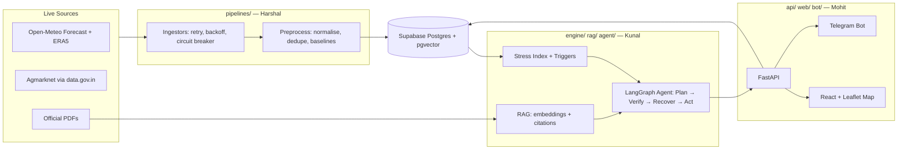

# 🛰️ Taluka Risk Radar

> Agentic early-warning and action system for climate-driven agricultural risk in Maharashtra's drought-prone belt.

[](https://github.com/harshalpatil-IITGN/-taluka-risk-radar/actions)

## Problem

Maharashtra's rainfed farm belt faces repeated weather shocks with thin buffers. Institutions that serve farmers (FPOs, cooperative banks, insurers, agriculture departments) lack a **taluka-level, trigger-aligned, auditable** early-warning view, so responses come late and are hard to justify.

## Solution

Taluka Risk Radar continuously ingests live weather, soil-moisture and mandi-price data for pilot talukas, computes a transparent **Taluka Stress Index** aligned with the state's drought-declaration triggers, and runs a **LangGraph agent** that retrieves official guidance (with citations), verifies its own numbers, and produces stakeholder-specific outputs.

## Architecture



## Quick Start

```bash
git clone https://github.com/harshalpatil-IITGN/-taluka-risk-radar.git && cd -taluka-risk-radar
cp .env.example .env            # fill in keys
python -m venv .venv && .venv\Scripts\activate  # Windows
pip install -r requirements.txt
pytest -q                        # sanity check
python -m pipelines.run_all      # ingest data (needs DATABASE_URL, DATA_GOV_IN_API_KEY)
uvicorn api.main:app --reload    # start API server
cd web && npm install && npm run dev  # start frontend
```

## Data Sources

| Source | Use | Licence |
|---|---|---|
| Open-Meteo Forecast + ERA5 | Weather, soil moisture, climatology | CC BY 4.0 (non-commercial free tier) |
| Agmarknet via data.gov.in | Mandi prices | India Open Government Data |
| Official PDFs (Drought Manual, CRIDA DACPs) | RAG corpus | Public domain |

> **Attribution:** Weather data by [Open-Meteo.com](https://open-meteo.com/)

## Tech Stack

| Layer | Technology |
|---|---|
| Backend | Python 3.11, FastAPI, Pydantic v2, httpx, tenacity |
| Database | Supabase Postgres + pgvector |
| Agent | LangGraph |
| LLM | Gemini (primary) → Groq (secondary) → templated (fallback) |
| Embeddings | multilingual-e5-small (384-d) |
| Frontend | React + Vite + react-leaflet |
| Hosting | Vercel (web), HF Spaces/Render (API), Supabase (DB) |

## Team

| Member | Role | Directories |
|---|---|---|
| **Harshal** | Data & Pipelines | `pipelines/`, `db/`, `contracts/schema.sql` |
| **Kunal** | AI, Engine & Agent | `engine/`, `rag/`, `agent/`, `evals/` |
| **Mohit** | Platform, API & UI | `api/`, `web/`, `bot/`, `infra/` |

## Limitations

- Pilot scope: ~50 talukas in Maharashtra's drought-prone belt
- Stress Index thresholds are heuristic (documented in `docs/model_card.md`)
- Free-tier API quotas apply (Open-Meteo: 10K calls/day)
- No pesticide/fertiliser dose recommendations

## Roadmap

- Sentinel-2 NDVI anomaly layer
- Bhashini voice (Marathi ASR/TTS)
- OpenAgriNet/Beckn adapter for MahaVISTAAR integration
- Multi-state expansion

## License

MIT
