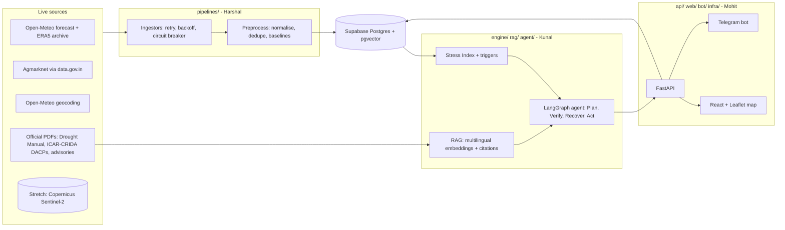

# PROJECT CONTEXT — Taluka Risk Radar (working title)

> Single source of truth for the hackathon build. Humans: read top to bottom once.
> Antigravity agents: read this file (via `@docs/PROJECT_CONTEXT.md`) before planning any task.
> Last updated: 31 Oct 2026. Build window: **2 days, 3 members, ₹0 budget.**

---

## 0. How to use this file in Antigravity

1. Place this file at `docs/PROJECT_CONTEXT.md` in the repo.
2. Create a **short** `AGENTS.md` at the repo root (snippet is in `02_STEP_BY_STEP_CHECKLIST.md`, Step 0). Antigravity reads project rules from `AGENTS.md` / `GEMINI.md` at the workspace root and from `.agents/rules/` (older projects use `.agent/rules/`). Rule files reportedly have a ~12,000-character limit, so keep `AGENTS.md` short and have it point here.
3. In the agent panel, attach this file with an `@` mention for any planning-heavy task.
4. Each member works only inside the directories they own (see `03_TEAM_WORK_SPLIT.md`).

---

## 1. One-paragraph snapshot

**Taluka Risk Radar** is an agentic early-warning and action system for climate-driven agricultural risk in Maharashtra's drought-prone belt. It continuously ingests live weather, soil-moisture and mandi-price data for a set of pilot talukas, computes a transparent **Taluka Stress Index** aligned with the state's drought-declaration triggers, and runs a **LangGraph agent** that retrieves official guidance (with citations), verifies its own numbers, and produces stakeholder-specific outputs: a Marathi farmer advisory, an English portfolio digest for FPOs/banks/insurers, and an evidence report. The product is sold to **institutions** (FPOs, cooperatives, rural lenders, insurers), not to individual farmers, and is designed to plug into the public MahaVISTAAR/Agristack ecosystem rather than compete with it.

---

## 2. Hackathon requirements (from the provided files)

### 2.1 Track
**Climate, Resource Infrastructure & Global Supply Resilience.** Combines predictive AI (geospatial analytics, time-series forecasting, vision) with autonomous agent execution (routing, orchestration, automated response).

Problem spectrum offered:
1. Multilingual Agritech & Resource Advisory Assistant (weather APIs + mandi prices + soil metrics → plain-language crop advice).
2. Predictive Climate & Micro-Location Yield Engine (satellite + soil + historical weather → micro-climate risk + mitigation plans).
3. Smart Grid & Urban Resource Allocation Controller (edge control agent).
4. Autonomous Emergency Response & Supply Chain Logistics Swarm.

**Our choice:** a hybrid of #2 (predictive micro-location engine) delivered through #1 (advisory), with an agent that acts (alerts, reports). We do not build #3 or #4.

### 2.2 Submission template (6 deliverables)
1. **Problem statement** — target issue & context; target audience.
2. **Solution description** — high-level overview (AI reasoning and/or agent workflows); technical architecture (stack, models, datasets, design).
3. **Prototype link** — live deployed URL (Vercel / Streamlit / HF Spaces etc.).
4. **Demo video** — 2–3 min, must show an end-to-end **live** run with real-time AI reasoning, tool use or agentic execution under realistic conditions.
5. **GitHub repo** — public; clean README with setup instructions, architecture diagram/flowchart, all source and config.
6. **Pitch deck** — 5–7 slides (Google Slides / Canva / PDF). Recommended structure: Title & Team → Problem & Context → Solution & Features → Technical Architecture & Innovation → Roadmap & Live Demo Summary.

### 2.3 Scoring rubric (100 pts)
| Pillar | Pts | What judges look for |
|---|---|---|
| Technical Architecture & Engineering Depth | 20 | Clean modular code, efficient API integration, low latency; **depth beyond a frontend wrapper** (custom RAG, geospatial/time-series models, complex state graphs) |
| AI Reasoning & Agentic Execution | 25 | Planning, multi-step tool calls, error handling, self-correction; accuracy, guardrails, minimal hallucination, **source attribution** |
| Problem Relevance, Impact & USP | 25 | Real-world value; differentiation vs chatbots/traditional software; innovation and scalability |
| Live Demonstration & Robustness | 30 | Runs live without crashing; handles unexpected input, missing data, flaky networks |

### 2.4 Strict compliance rules (disqualification risk)
- **No dummy data. Zero tolerance.** No hardcoded JSON, static mock datasets or fake placeholder numbers. The running app must consume real-time APIs, live databases or **official open datasets** (IMD, ISRO Bhuvan, Data.gov.in, etc.).
- Open-source libraries/SDKs/boilerplate are allowed, but **all core logic, AI models and agent workflows must be built during the hackathon window.**
- **Every team member must be able to explain the architecture, data flow and AI logic independently** if questioned.

### 2.5 How we interpret "no dummy data" (project policy)
- Production/demo build reads **only** from live APIs and the live database.
- Official reference tables (taluka list, MSP, drought-declaration list, documents for RAG) are real data from official sources. They are loaded by **seed scripts** that cite `source_url` in the table — we do not hand-type numbers into JSON.
- Recorded real API responses may exist in `tests/fixtures_recorded/` for unit tests only, labelled as such. The deployed app must never read them.
- A mock server (e.g. for UI development) is allowed locally only. CI fails if `MOCK_MODE=true` in a production build.

---

## 3. Constraints and assumptions

- Time: 2 days. Team: 3 (Harshal, Kunal, Mohit). Budget: ₹0 (free tiers only).
- IDE: Antigravity (agentic IDE). Use Planning mode for multi-step work; review every diff.
- Free-tier limits and API parameter names **must be re-verified on day 1** — they change and could not be live-tested while writing this document.
- Geography for the pilot: ~50 talukas across Marathwada, Vidarbha (Amravati + Nagpur divisions) and north Maharashtra, plus a few surplus-rainfall control talukas (e.g. Pune/Nashik/Satara region) so the map shows contrast.
- Date context: today is 31 Oct 2026. The 2026 kharif season just ended with a drought declaration; rabi sowing is starting. Live demo mode = "post-monsoon status + rabi sowing outlook". Backtest mode = replay of Jun–Sep 2026.

---

## 4. Problem and verified evidence

### 4.1 Problem statement (use in submission)
Maharashtra's rainfed farm belt faces repeated weather shocks (delayed monsoon, long dry spells, unseasonal rain) with thin buffers (low irrigation, slow payouts, fragmented information). Institutions that serve farmers (FPOs, cooperative banks, insurers, agriculture departments) lack a **taluka-level, trigger-aligned, auditable** early-warning view, so responses (advisories, credit decisions, claims evidence, relief requests) come late and are hard to justify.

**Target audience:** FPO/cooperative managers, rural lenders, crop insurers/aggregators, district agriculture/revenue staff; end beneficiaries are smallholder farmers in drought-prone talukas.

### 4.2 Verified facts (cite these; do not exceed them)
**Maharashtra**
- NCRB 2023: Maharashtra accounted for 38.5% of India's farm-sector suicides; Marathwada and Vidarbha are the epicentres. (Handle this statistic with care in the pitch — state it factually, never dramatise.)
- 2026 monsoon: state declared drought in **265 of 358 tehsils** after an 18% seasonal rainfall deficit (1 Jun–26 Sep 2026); Marathwada −38%, Vidarbha −27%.
- Reported drought-trigger criterion: rainfall deficit > 25% combined with a dry spell of roughly 21 days (Drought Management Code 2016 framework). Treat the exact thresholds as "reported" and make them configurable.
- Marathwada recorded 465 farmer suicides in Jan–Jun 2026 (divisional commissioner report via PTI).
- Soybean: farmers sold at ~₹4,000–4,500/qtl last season vs MSP ₹5,328; NAFED/NCCF procured 6.02 lakh tonnes (15 Nov 2025–12 Feb 2026) and open-market bids exceeded MSP at times → the problem is price **volatility/timing**, not only low prices.
- Cotton area in Maharashtra fell ~4.59 lakh ha over four years, attributed to high labour costs and low mechanisation. (No verified state-vs-state input-cost comparison — do **not** claim "spiking costs" without CACP data.)

**Gujarat (for context / roadmap only — corrects an earlier assumption that Gujarat weather is "stable")**
- Oct 2025 unseasonal rain damaged ~4.2 million ha; ₹10,000 crore relief package; ₹9,466 crore paid to 32.49 lakh farmers by Jan 2026 (adequacy was disputed, including from within the ruling party).
- 2026: monsoon late with one of the highest early deficits; on 26 Oct 2026 the state announced drought relief for four districts.
- Real structural difference is **irrigation**: ~49.3% of Gujarat's crop area irrigated in 2024-25; an older Agriculture Ministry table (2007-08) shows ~41.7% vs ~19.6% for Maharashtra.

**Do NOT claim:** "Gujarat has stable weather", anything about political stability as a driver, or any unsourced cost/price figure.

### 4.3 Pitch narrative (safe version)
"Weather volatility now hits both Gujarat and Maharashtra. What differs is the buffer — irrigation, payout speed and information. Maharashtra's rainfed belt has the thinnest buffer, so that is where early, taluka-level, auditable warning is worth the most."

---

## 5. Competitive landscape

| Player | What it does | Implication |
|---|---|---|
| **MahaVISTAAR-AI** (Maharashtra govt + PoCRA) | Free multilingual advisory chatbot; reported >3M farmers; voice telephony added in 2026; built on OpenAgriNet (Beckn) with pluggable LLMs | A farmer chatbot loses at ₹0 vs a free state product. **Integrate later, don't compete.** |
| **Bharat-VISTAAR** (Centre, launched Feb 2026) | National AI assistant; phase-1 states include Maharashtra and Gujarat | Same as above |
| Skymet, SatSure, Cropin and similar | Sell weather/satellite analytics to insurers and agri-businesses | Our wedge: taluka-level, trigger-aligned, open-data, Marathi-first, **agent that acts and produces auditable evidence** |

**USP (one line):** *Taluka-level, declaration-aligned drought and weather-risk triggers on open data, with an agent that explains itself with citations and produces ready-to-use alerts and evidence reports for institutions.*

---

## 6. Product definition

### 6.1 Personas
- **P1 — FPO manager (primary demo persona), e.g. Jalna/Yavatmal:** wants to know which member villages are at risk this week, what to advise, and what to send.
- **P2 — Cooperative bank / NBFC credit officer:** wants a ranked list of talukas/villages in their portfolio with stress levels and reasons.
- **P3 — Insurer/agri-department analyst:** wants an evidence pack (rainfall deficit, dry spell, soil moisture, forecast) for a taluka and date range.

### 6.2 User stories
1. As an FPO manager I pick a taluka and see its current stress level, why, and the next-7/16-day outlook.
2. I click "Generate advisory" and get a Marathi message (plus English) grounded in official guidance with citations.
3. I upload/paste a list of villages and get a ranked portfolio digest.
4. I get a Telegram alert when my taluka crosses WATCH/HIGH.
5. I can open an evidence report showing the data and rules behind any alert.
6. If a data source is down I still get an answer, clearly marked stale/degraded.

### 6.3 Scope tiers (2 days — be ruthless)
**P0 — must exist in the demo**
- Live ingestion (weather + forecast + soil moisture) for ~50 pilot talukas; mandi prices for key crops.
- Stress Index + trigger engine with explainable components.
- Map dashboard (taluka markers coloured by level) + detail panel.
- LangGraph agent with tools, RAG citations, Verify node, Recover node; Marathi + English outputs.
- Source-health endpoint, stale badges, **chaos toggle** (disable a source live).
- Deployed public URL, README + diagram, 2–3 min video, 5–7 slide deck.

**P1 — do if P0 is green by Day 2 midday**
- Backtest against the 2026 drought-declared tehsil list (precision/recall/lead time) committed as `evals/results/backtest.md`.
- Telegram bot (alerts + `/risk <taluka>`).
- Portfolio upload (paste a list of villages/talukas).
- Evidence report export (HTML/Markdown; PDF optional).

**P2 — stretch only**
- Sentinel-2 NDVI anomaly via Copernicus (Statistical API) for 1–3 districts.
- Bhashini ASR/TTS voice; browser speech as fallback.
- OpenAgriNet/Beckn adapter write-up (roadmap slide, not code).

### 6.4 Non-goals
Fine-tuning models, native mobile app, WhatsApp Business API, multi-state coverage, pesticide/fertiliser dose recommendations, financial/trading advice.

---

## 7. Customers and go-to-market (for the deck and Q&A)

| Priority | Segment | Why they buy | Entry |
|---|---|---|---|
| 1 | FPOs/FPCs; sugar and dairy cooperatives | Members + field staff; need risk visibility and advisories | Low-cost SaaS pilots |
| 2 | District/rural cooperative banks, NBFCs, MFIs | Portfolio-level crop-stress alerts for credit and recovery | Per-portfolio subscription |
| 3 | Crop insurers and aggregators | Crop insurance is the 3rd-largest general-insurance line; PMFBY mandates remote-sensing-based yield estimates (30% weightage; paddy/wheat from Kharif 2023, soybean from Kharif 2024) | Evidence reports, portfolio risk |
| 4 | Agri-input companies/dealers | Demand timing from stress maps | Data feed |
| 5 | Government (agriculture/revenue/relief depts, PoCRA) | Declaration triggers and relief targeting | Pilot/MoU; slow procurement, so not first revenue |

**Post-hackathon path:** 10 customer-discovery calls in 2 weeks; swap non-commercial data licences (Open-Meteo → paid/self-hosted); DPDP Act consent for farmer data; price per portfolio/taluka; position as a layer over Agristack/MahaVISTAAR via open network standards.

---

## 8. System architecture



### 8.1 Stack (all free tier — verify limits)
| Layer | Choice | Fallback |
|---|---|---|
| Backend | Python 3.11, FastAPI, Pydantic v2, httpx, tenacity | — |
| DB | Supabase Postgres + pgvector (no PostGIS needed: we use taluka HQ lat/lon) | Neon |
| Scheduler | GitHub Actions cron (every 3–6 h) + `/admin/refresh` | APScheduler in worker |
| Agent | LangGraph | plain state machine |
| LLM | Gemini API free tier (primary) → Groq free tier (secondary) → templated output from computed numbers (last resort); Ollama locally | OpenRouter free models |
| Embeddings | `multilingual-e5-small` (sentence-transformers, CPU) | Gemini embeddings |
| Frontend | React + Vite + react-leaflet (OSM tiles) | Streamlit (emergency only) |
| Bot | Telegram Bot API (webhook into FastAPI) | polling worker |
| Hosting | Vercel (web), Hugging Face Spaces Docker or Render (API), Supabase (DB) | — |
| CI | GitHub Actions: ruff, pytest, build, secret scan | — |

Free backends sleep: add a warm-up ping and pre-warm before judging.

### 8.2 Repository layout
```
taluka-risk-radar/
├─ AGENTS.md                 # short rules for Antigravity (see checklist Step 0)
├─ README.md
├─ .env.example
├─ docs/                     # PROJECT_CONTEXT.md, CHECKLIST, TEAM_SPLIT, architecture.md, demo_script.md
├─ contracts/                # schema.sql, openapi.yaml, models.py (Pydantic) — shared, PR-only changes
├─ db/                       # migrations + repo.py (read/write helpers)         [Harshal]
├─ pipelines/                # ingestors, preprocess, seeds, run_all.py           [Harshal]
├─ engine/                   # stress index, triggers, SPI, backtest functions    [Kunal]
├─ rag/                      # ingest docs, embed, retrieve                       [Kunal]
├─ agent/                    # graph.py, nodes.py, tools.py, guardrails.py        [Kunal]
├─ evals/                    # backtest.py, groundedness tests, results/          [Kunal]
├─ api/                      # FastAPI app, routers, SSE                          [Mohit]
├─ web/                      # React app                                          [Mohit]
├─ bot/                      # Telegram handlers                                  [Mohit]
├─ infra/                    # Dockerfile, compose, .github/workflows             [Mohit]
└─ tests/                    # unit tests; fixtures_recorded/ (recorded REAL responses, tests only)
```

---

## 9. Data sources

> **Day-1 task (Harshal, first 2 hours): smoke-test every source below and record status, quota and exact parameter names in `docs/data_sources.md`.** Nothing here was live-tested while drafting.

| Source | Use | Access notes |
|---|---|---|
| **Open-Meteo Forecast** `https://api.open-meteo.com/v1/forecast` | Daily precip, Tmax/Tmin, ET0; hourly soil moisture; 16-day horizon; `past_days` for recent history | Free tier is **non-commercial**, under 10,000 calls/day, 5,000/hour, 600/min; attribution "Weather data by Open-Meteo.com" must be shown in the UI. Batch multiple coordinates per call (verify). |
| **Open-Meteo Archive (ERA5)** `https://archive-api.open-meteo.com/v1/archive` | 1991–2020 climatology for rainfall normals/SPI; replay of Jun–Sep 2026 for backtest | Data from 1940; recent days lag a few days |
| **Open-Meteo Geocoding** `https://geocoding-api.open-meteo.com/v1/search` | Resolve taluka HQ names (English/Marathi) → lat/lon; also place resolution for user input | Cache results in `taluka` table |
| **Agmarknet via data.gov.in** resource `9ef84268-d588-465a-a308-a864a43d0070` at `https://api.data.gov.in/resource/<id>` | Daily mandi min/max/modal price by state/district/market/commodity/variety/grade/arrival_date | Needs a free API key. Developers report friction with official sources → this is why ingestion needs retries, caching and a fallback to last-good. Confirm field ids via the resource metadata. |
| **MSP reference** (CACP / PIB official releases) | Compare modal price vs MSP | Load via seed script with `source_url`; never hand-type |
| **Drought declaration list** (Maharashtra Revenue / Relief & Rehabilitation GR, or official notification) | Backtest labels (265/358 tehsils) | Parse from the official document; if not obtainable in time, fall back to district-level IMD deficits + the 25% / 21-day rule and say so honestly |
| **Official documents for RAG** | Drought Manual 2016, ICAR-CRIDA district contingency plans (DACPs) and bulletins, state agricultural-university advisories, PMFBY guidelines | Public PDFs; store `source_url`, page numbers |
| **Taluka list** | `taluka` table (name_en, name_mr, district, division, lat, lon) | Official taluka list (e.g. LGD / state portals) + Open-Meteo geocoding for coordinates |
| *(Stretch)* Copernicus Data Space — Sentinel-2 L2A via Statistical API / STAC | NDVI anomaly vs 5-yr median | Free account + OAuth client; clouds → use SCL mask and composites |
| *(Stretch)* Bhashini | Marathi ASR/TTS | Needs registration; verify access |

### 9.1 Fault-tolerance policy (applies to every ingestor)
- Timeouts on every call (connect 5 s / read 20 s).
- Retries with exponential backoff + jitter (tenacity), max 4 attempts; respect 429/Retry-After.
- Circuit breaker per source: open after 5 consecutive failures, half-open after 10 min.
- Idempotent upserts with unique keys (see schema).
- Store raw payload hash/size and `fetched_at`; write one `source_health` row per run.
- Schema validation (Pydantic) — invalid rows go to `ingest_dead_letter`, never silently dropped.
- Fallback chain for weather: Open-Meteo → cached last-good (flag `stale=true`, show age). Add NASA POWER as a second source only if time permits.
- Every API/tool result carries `source`, `as_of`, `stale`.
- Staleness thresholds: weather > 12 h = stale; prices > 48 h = stale; anything older is shown with a warning and lowers confidence.

---

## 10. Data model (contract v0.1 — `contracts/schema.sql`)

```sql
create extension if not exists vector;

create table taluka (
  id serial primary key,
  name_en text not null, name_mr text,
  district text not null, division text not null,
  lat double precision not null, lon double precision not null,
  lgd_code text, pilot boolean default true,
  drought_declared_2026 boolean,           -- backtest label, nullable
  label_source_url text,
  unique (name_en, district)
);

create table weather_daily (
  taluka_id int references taluka(id),
  date date not null,
  is_forecast boolean not null,
  precip_mm real, tmax_c real, tmin_c real, et0_mm real,
  soil_moisture_0_7cm real,
  source text not null, fetched_at timestamptz not null,
  primary key (taluka_id, date, is_forecast, source)
);

create table climatology (               -- from ERA5 1991-2020
  taluka_id int references taluka(id),
  window_days int not null,              -- e.g. 30, 60, season-to-date handled in code
  month int not null,
  gamma_shape double precision, gamma_scale double precision, p_zero double precision,
  normal_season_mm_by_day jsonb,         -- cumulative normal since 1 Jun, by day-of-season
  source text, computed_at timestamptz,
  primary key (taluka_id, window_days, month)
);

create table mandi_price (
  id bigserial primary key,
  state text, district text, market text, commodity text, variety text, grade text,
  arrival_date date not null,
  min_price numeric, max_price numeric, modal_price numeric,
  fetched_at timestamptz not null,
  unique (market, commodity, variety, grade, arrival_date)
);

create table msp_reference (
  commodity text, season text, price_per_quintal numeric,
  source_url text not null, loaded_at timestamptz,
  primary key (commodity, season)
);

create table source_health (
  source text primary key,
  last_attempt_at timestamptz, last_success_at timestamptz,
  status text,                           -- OK | DEGRADED | DOWN | DISABLED_CHAOS
  last_error text, latency_ms int, rows_written int
);

create table ingest_dead_letter (
  id bigserial primary key, source text, payload jsonb, error text, created_at timestamptz default now()
);

create table risk_score (
  taluka_id int references taluka(id),
  as_of_date date not null,
  stress_index real not null,            -- 0-100
  level text not null,                   -- LOW | WATCH | HIGH | SEVERE
  components jsonb not null,             -- each component value, weight, contribution
  triggers jsonb not null,               -- which rules fired and thresholds used
  data_freshness jsonb not null,         -- per-source as_of + stale flags
  confidence real,
  computed_at timestamptz not null,
  primary key (taluka_id, as_of_date)
);

create table doc_chunk (
  id bigserial primary key,
  doc_id text, title text, source_url text, page int, lang text,
  text text not null, embedding vector(384)
);

create table agent_run (
  id uuid primary key, started_at timestamptz, taluka_id int, audience text, language text,
  status text, trace jsonb, output jsonb, error text
);

create table alert (
  id bigserial primary key, taluka_id int, created_at timestamptz default now(),
  level text, channel text, audience text, language text,
  message text, evidence jsonb, delivered boolean default false
);
```

Rules: only **Harshal** edits `schema.sql`/migrations. Others request changes by issue; change is announced in chat.

---

## 11. Stress Index and triggers (engine spec v0.1 — Kunal)

**Inputs (per taluka, as_of date):** observed daily precip since 1 Jun, soil moisture, forecast next 7/16 days, ERA5 climatology.

**Components (configurable weights in `engine/config.py`):**
| Component | Definition | Weight |
|---|---|---|
| Seasonal rainfall deficit % | (cumulative since 1 Jun − normal) / normal | 30 |
| Current dry-spell length | consecutive days below the rainy-day threshold (default 2.5 mm; configurable) | 25 |
| SPI (30- and 60-day) | gamma-fit on ERA5 climatology, standard-normal transform | 20 |
| Soil-moisture anomaly | current vs same-period climatology | 15 |
| Forecast shortfall (next 7 days) | forecast rainfall vs normal for window | 10 |
| *(Stretch)* NDVI anomaly | vs 5-yr median | re-normalise weights when present |

When a component is missing, re-normalise the remaining weights and lower `confidence`; never fill with a made-up value.

**Levels:** 0–25 LOW, 25–50 WATCH, 50–75 HIGH, 75–100 SEVERE (heuristic; document it as such).

**Declaration-aligned triggers (reported criterion, configurable):**
- `T1_DROUGHT_STRESS`: seasonal deficit > 25% **and** dry spell ≥ 21 days.
- `T2_DRY_SPELL_CRITICAL`: dry spell ≥ 14 days during a sensitive window (config).
- `T3_FORECAST_DRY`: next-7-day forecast < 20% of normal.
- `T4_UNSEASONAL_RAIN`: > X mm in 24–48 h outside normal season (config; used for the Gujarat-style event story).

**Backtest (P1, but high value for the accuracy pillar):**
- Replay 1 Jun–26 Sep 2026 using ERA5 archive data for pilot talukas.
- Label = `drought_declared_2026`. Report precision, recall, F1 and **lead time** (days between first T1 firing and the declaration/last-known date).
- Tune thresholds on a subset, report on the held-out subset. State sample size honestly (e.g. "n=50 pilot talukas").
- Output `evals/results/backtest.md` and show the headline numbers on a deck slide.

---

## 12. RAG spec (Kunal)

- **Corpus (minimum 4 documents for the demo):** Drought Management Code/Manual 2016; ICAR-CRIDA district contingency plans for 3–5 pilot districts; one state agricultural-university advisory set (e.g. kharif/rabi crop advisories); PMFBY operational guidelines.
- Chunk by section/page (~300–500 tokens), keep `title`, `source_url`, `page`.
- Embeddings: `multilingual-e5-small` (384-d) into `doc_chunk.embedding` with pgvector cosine search.
- Retrieval returns top-k with scores; **if the best score is below a threshold, the agent must say "no official guidance found" instead of improvising.**
- Every generated advisory sentence that contains guidance must carry a `[doc title, p.X]` citation.

---

## 13. Agent spec (Kunal)

### 13.1 Graph (LangGraph)
`Monitor → Detect → Retrieve → Plan → Verify → Act → (Recover on any failure)`

| Node | Responsibility |
|---|---|
| Monitor | Entry for scheduled runs (all talukas) or on-demand runs (one taluka/portfolio) |
| Detect | Call `get_risk`; decide if level/triggers warrant action; pick audience |
| Retrieve | `search_docs` for guidance relevant to the fired triggers, crop and district |
| Plan | LLM drafts actions and message(s) in the requested language(s), using only tool outputs and retrieved chunks |
| Verify | Deterministic checks: every number in the draft exists in tool outputs; every guidance sentence has a citation; data not stale (or flagged); no banned content (doses, financial advice). On failure → loop back to Plan once with the error list |
| Act | Persist `agent_run`, create `alert`, send Telegram message, render evidence report |
| Recover | On tool/LLM failure: retry → switch source/model → templated output built from computed numbers; mark run `DEGRADED` with reason |

### 13.2 Tools (typed; defined in `contracts/models.py`, implemented in `agent/tools.py`)
- `resolve_place(text) -> list[TalukaMatch]` (fuzzy match English/Marathi, typo-tolerant, state check)
- `get_risk(taluka_id, as_of=None) -> RiskResult`
- `get_forecast(taluka_id, days=7) -> ForecastResult`
- `get_prices(commodity, district=None, days=14) -> PriceResult` (includes modal price vs MSP, trend)
- `search_docs(query, k=5, lang=None) -> list[DocHit]`
- `send_alert(taluka_id, level, message, channel, language) -> AlertResult`
- `render_evidence_report(taluka_id, as_of) -> ReportResult`

Every result includes `source`, `as_of`, `stale: bool`, and `error: str | None`.

### 13.3 Guardrails
- No pesticide/fertiliser dosages, no seed-variety endorsements without a retrieved citation, no buy/sell/hold advice — show "price vs MSP" as information only, with a "consult local KVK/agriculture officer" note.
- Refuse out-of-scope questions (politics, medical, etc.) with a short redirect.
- Respond in the user's language (Marathi / English / Hindi). Numbers and units must match tool outputs exactly.
- When data is stale or missing, say so in the answer's first line and lower the stated confidence.
- Farmer-distress statistics are never used in generated advisories.

### 13.4 Outputs
1. **Farmer advisory** (Marathi + English): ≤ 120 words, 3 actions max, citations.
2. **Portfolio digest** (English): ranked table of talukas with level, top reason, next-7-day outlook.
3. **Evidence report**: inputs, computed components, triggers fired with thresholds, data freshness, citations.

### 13.5 Agent evals (`evals/`)
- 20 scripted prompts: normal, Marathi, Hinglish, typo, unknown place, non-Maharashtra place, off-topic, stale data, source down, LLM rate-limited.
- Automated checks: citation present, numeric consistency, language matches, refusal behaviour, graceful degradation.
- Save results to `evals/results/agent_evals.md`.

---

## 14. API contract v0.1 (`contracts/openapi.yaml` — Mohit owns, all review)

| Method & path | Purpose |
|---|---|
| `GET /health` | Liveness |
| `GET /sources/status` | Rows from `source_health` + staleness flags (shown in UI) |
| `GET /talukas?division=&q=` | List/search talukas |
| `GET /risk/map` | Latest `risk_score` for all pilot talukas (map markers) |
| `GET /risk?taluka_id=&as_of=` | Full risk detail with components, triggers, freshness |
| `GET /prices?commodity=&district=` | Mandi prices with MSP comparison and stale flag |
| `POST /agent/run` | Body: `{taluka_id \| place_text, audience, language}` → `{run_id}` |
| `GET /agent/runs/{id}/stream` | SSE stream of trace events (node, tool call, result, verify result) |
| `GET /agent/runs/{id}` | Final output |
| `POST /portfolio/analyze` | Body: list of place names → ranked digest |
| `POST /telegram/webhook` | Telegram updates |
| `POST /admin/chaos` | Body: `{source, enabled}` — simulate an outage (protected by admin token) |
| `POST /admin/refresh` | Trigger ingestion (protected) |

Standard error shape: `{ "error": {"code": "...", "message": "...", "retryable": bool} }`. The API must never return a stack trace.

---

## 15. Frontend spec (Mohit)

- **Map view:** Leaflet markers (taluka HQ) coloured by level; legend; division filter; data-freshness chip; footer attribution "Weather data by Open-Meteo.com".
- **Taluka panel:** stress gauge, component bars, triggers fired, 16-day rainfall chart (recharts), price vs MSP chart.
- **Agent panel:** "Generate advisory" button → live **trace view** (node names, tool calls, verify pass/fail, citations) via SSE → final Marathi + English message.
- **Portfolio tab:** paste villages/talukas → ranked table.
- **System health drawer:** source statuses, last success, stale badges; admin-only **chaos toggle**.
- **Resilience:** loading skeletons, empty-state messages, retry button, no raw errors; works on mobile width.

---

## 16. Robustness checklist (30 demo points)

- Source down / empty response → fallback + stale badge + degraded run.
- Misspelt or Marathi place name; place outside Maharashtra; ambiguous place (ask to choose).
- No satellite pass / missing component → weight re-normalisation + lower confidence.
- LLM rate-limit/timeouts → secondary model → templated output.
- Off-topic or prompt-injection attempt in user text → refusal; tool outputs and retrieved text are treated as data, never instructions.
- Date in past/future; backend cold start (UI shows "waking up", retries).
- Concurrent users: API is stateless; SSE per run; DB connection pooling.

---

## 17. Deployment and secrets

**Topology:** Vercel (web) → Hugging Face Space or Render (FastAPI Docker) → Supabase (Postgres+pgvector). GitHub Actions cron → `/admin/refresh` (or runs `python -m pipelines.run_all`).

**Environment variables (`.env.example`, values never committed):**
`DATABASE_URL`, `SUPABASE_URL`, `SUPABASE_KEY`, `DATA_GOV_IN_API_KEY`, `GEMINI_API_KEY`, `GROQ_API_KEY`, `TELEGRAM_BOT_TOKEN`, `TELEGRAM_WEBHOOK_SECRET`, `ADMIN_TOKEN`, `ALLOWED_ORIGINS`, `MOCK_MODE=false`.

**Accounts to create in hour 0:** Google AI Studio (Gemini key), data.gov.in (API key), Supabase, Hugging Face, Vercel, GitHub org/repo, Telegram BotFather. Share secrets through a password manager, not chat or repo.

---

## 18. Git and conventions

- Monorepo; `main` protected; branches `feat/<area>-<thing>`, `fix/<area>-<thing>`; PRs < ~300 lines, merged at least daily; one reviewer, chosen so the consumer reviews the producer (Kunal reviews Harshal, Mohit reviews Kunal, Harshal reviews Mohit — see `TEAM_WORK_SPLIT`).
- `CODEOWNERS` by directory; conventional commits (`feat:`, `fix:`, `docs:`, `chore:`).
- Python: ruff + black + type hints; TypeScript: eslint + prettier; pre-commit hooks.
- Never commit secrets; secret-scan in CI.
- Integration freeze 6 hours before submission; tag `v1.0-submission`.

---

## 19. Rubric mapping (what to show for each pillar)

| Pillar | Evidence we will show |
|---|---|
| Architecture & depth (20) | Modular repo, ingestion with circuit breakers, SPI/stress-index engine, pgvector RAG, LangGraph state graph, tests, CI |
| AI reasoning & agentic (25) | Visible trace: plan → tool calls → Verify (numeric + citation checks) → Recover; backtest numbers; groundedness evals; refusal behaviour |
| Relevance, impact & USP (25) | Verified 2026 drought context; taluka-level trigger alignment; institutional buyers; integration path with MahaVISTAAR/Agristack; clear differentiation from chatbots |
| Live demo & robustness (30) | Live deployed URL; source-health panel; chaos toggle demo; messy-input demo (Marathi/typo/unknown place) |

---

## 20. Risks and fallbacks

| Risk | Fallback |
|---|---|
| Taluka polygons/coordinates hard to source | Use HQ points via geocoding; markers not polygons |
| Drought-declared taluka list not obtainable | Backtest on district-level deficits + rule; state limitation openly |
| Agmarknet API unreliable | Cache last-good; show stale; limit to 5 commodities (soybean, cotton, tur, gram, onion) |
| LLM free-tier rate limits | Secondary model → templated output; cache advisories per (taluka, date, language) |
| Free hosting cold starts | Warm-up ping; pre-warm 10 min before demo; recorded fallback video |
| NDVI too heavy | Drop it (P2); say so on the roadmap slide |
| A teammate blocked or ill | Buddy-cover pairs in TEAM_SPLIT |
| Contract drift | Contracts change only via PR + announcement; consumers review |

---

## 21. Glossary

- **Taluka / tehsil:** sub-district administrative unit; drought is declared per tehsil.
- **SPI:** Standardized Precipitation Index.
- **DACP:** District Agricultural Contingency Plan (ICAR-CRIDA).
- **MSP:** Minimum Support Price.
- **FPO/FPC:** Farmer Producer Organisation/Company.
- **PMFBY / YES-TECH:** crop insurance scheme / technology-based yield estimation.
- **Mandi / Agmarknet:** wholesale market / national market-price portal.
- **PoCRA:** Project on Climate Resilient Agriculture (Maharashtra).

---

## 22. Source list (for README and deck footnotes)

- Maharashtra drought declaration (265/358 tehsils): https://www.drishtiias.com/state-pcs-current-affairs/maharashtra-declares-drought-in-75-of-the-state
- Reported drought-trigger criterion: https://spmiasacademy.com/currentaffairs/drought-in-maharashtra/
- Gujarat/Rajasthan 2026 drought declarations: https://www.downtoearth.org.in/amp/story/climate-change/gujarat-rajasthan-declare-drought-in-18-districts-as-rainfall-deficit-hits-farmers
- Gujarat Oct 2025 unseasonal-rain package: https://deshgujarat.com/2025/11/07/gujarat-govt-announces-%E2%82%B910000-crore-relief-package-for-farmers-hit-by-unseasonal-rains/
- Gujarat disbursal (Jan 2026): https://ianslive.in/gujarat-govt-disburses-rs-9466-crore-to-32-lakh-farmers-hit-by-unseasonal-rains--20260121174416
- NCRB 2023 farm-sector suicides: https://vajiramandravi.com/current-affairs/upsc-mains-current-affairs/2025/10/01
- Marathwada 2026 H1 figures: https://www.dailypioneer.com/news/465-farmer-suicides-recorded-in-marathwada-region-in-2026
- Soybean vs MSP: https://cropgpt.ai/maharashtra-cotton-acreage-to-rise-as-farmers-shift-from-soybean
- Soybean procurement: https://www.indiancooperative.com/co-op-news-snippets/price-fall-triggers-msp-push-by-nafed-nccf/amp
- Cotton area decline: https://www.business-standard.com/topic/cotton
- Irrigation 2024-25 (Gujarat): https://agrospectrumindia.com/news/24/34769/acreage-holds-up-in-decades-most-distorted-monsoon-key-risks-shift-to-yields-and-winter-crop-prospects.html
- Irrigation coverage 2007-08 table: https://desagri.gov.in/wp-content/uploads/2021/04/tb14.4U.pdf
- MahaVISTAAR/MahaAgX launch: https://agrospectrumindia.com/news/71/33499/maharashtra-launches-mahaagx-and-indias-first-bhili-tribal-llm-at-ai4agri2026.html
- OpenAgriNet architecture: https://www.iiitb.ac.in/includefiles/userfiles/files/Annexure%2014.docx
- PMFBY YES-TECH: https://eparlib.sansad.in/bitstream/123456789/2996958/1/AU383_HoJZys.pdf
- Crop insurance white paper: https://www.tcs.com/content/dam/global-tcs/en/pdfs/insights/whitepapers/crop-insurance-loan-digital-innovations.pdf
- Open-Meteo terms: https://open-meteo.com/en/terms
- Agmarknet OGD dataset: https://data.gov.in/resource/current-daily-price-various-commodities-various-markets-mandi
- ICAR-CRIDA weekly bulletins (DACPs, agromet): https://www.icar-crida.res.in/WDU/2026/AUG_2026/NAAS-Bulletin-17-August-2026.pdf
